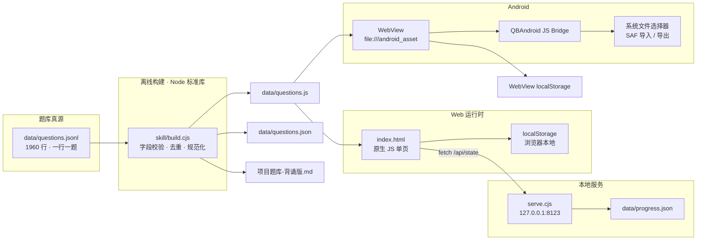

<div align="center">

# 项目题库 · Embodied AI Question Bank

**一套可以离线跑十年的具身智能题库：1960 道题、14 个领域、236 份来源、零后端、零依赖。**

从 VLA 模型族谱到全身控制，从世界模型到水下机器人，从数据工程到边缘部署——练题、背诵、错题、考试、统计，一个 HTML 全部搞定。

[](#题库全景)
[](#题库全景)
[](#题库全景)
[](#技术架构)
[](APK/README.md)

[项目简介](#项目简介) · [快速开始](#快速开始) · [题库全景](#题库全景) · [题库示例](#题库示例) · [技术架构](#技术架构) · [Android APK](#android-apk) · [常见问题](#常见问题)

</div>

---

## 项目简介

这是一套面向**具身智能 / 机器人学习**的离线题库，题目不是网上抓来的选择题合集，而是按知识体系逐题编写、逐题标注来源的复习材料。

它解决三个具体问题：

- **资料太散**：VLA、RL、WBC、MPC、仿真、数据、部署分散在几百篇论文和仓库里，缺少一条从概念到选型的完整路径。
- **看完就忘**：只读论文不动手，遇到“π0.5 和 RDT 怎么选”“WBC 的 QP 到底解什么”仍然答不上来。
- **工具太重**：为了刷题装一个 App、注册一个账号、连一个数据库，成本和收益不成比例。

所以这里选择最笨也最稳的方案：**一个 HTML 文件 + 一份 JSONL 题库**。不联网、不登录、不依赖框架，双击就能用，十年后还能打开。

### 适合谁

- 准备具身智能 / 机器人算法面试，需要系统过一遍知识面的人
- 刚进 VLA、运动控制、灵巧手方向，需要建立术语地图的研究生和工程师
- 想快速判断“这个模型/框架/方案适不适合我”的工程选型者
- 需要一份可离线、可打印、可导入 Anki 的复习材料的自学者

---

## 亮点

- **1960 道题，全部带答案、解析、出处**：不是只有 ABCD，每题都有 `explanation`，多数还有 `pitfall` 易错点。
- **14 个领域，12 个 ID 前缀**：从 `VLA-001` 到 `FRONT-120`，每个领域独立编号，方便按块复习。
- **5 种题型**：选择题、判断题、填空题、简答题、论述题，覆盖识记、辨析、推导和系统设计。
- **236 份来源**：每道题的 `source` 指向具体讲义、论文或官方文档，可回溯、可核对。
- **7 种使用模式**：练习、模拟考试、错题本、收藏夹、垃圾箱、背诵、统计。
- **答对自动跳题**：选择题/判断题/填空题答对后 0.8 秒进入下一题，答错停留看解析。
- **软删除**：任何模式下都能把题放进垃圾箱，不永久删除，也不再出现在练习和考试里。
- **三种运行形态**：双击 HTML、本地 Node 服务、Android APK，同一份题库、同一套交互。
- **零运行时依赖**：没有 React、没有打包器、没有 CDN、没有网络请求，断网也能用。
- **为低配设备设计**：背诵 50 题/页、答题卡 100 题/页、写入合并 300ms，千元机也不卡。

---

## 快速开始

### 方式一：Windows 一键启动（推荐）

```bat
git clone https://github.com/lookforwardforever/question-bank.git
cd question-bank
双击 启动刷题.cmd
```

启动后会自动打开 `http://127.0.0.1:8123`，进度写入 `data/progress.json`，换浏览器也不会丢。

需要 Node.js。没有安装时，脚本会自动回退到直接打开 `index.html`。

### 方式二：直接打开 HTML

双击 `index.html` 即可。无需 Node、无需服务器。

> 注意：`file://` 和 `http://127.0.0.1:8123` 是**两个不同的存储空间**。两种方式混用，进度不会互通。建议固定一种入口。

### 方式三：Android APK

下载 [question-bank-v1.0.0.apk](APK/question-bank-v1.0.0.apk)，传到手机安装，允许“安装未知应用”即可。

- 包名：`com.zihan.questionbank`
- 最低 Android 8.0（API 26），目标 Android 17（API 37）
- 体积：约 0.55 MB
- 权限：不申请网络、相机、麦克风、存储权限

更多说明见 [APK/README.md](APK/README.md) 和 [APK/TEST-REPORT.md](APK/TEST-REPORT.md)。

### 一行启动命令

```bash
node serve.cjs
```

---

## 题库全景

### 领域分布

| # | 领域 | 题量 | ID 前缀 | 代表关键词 |
|---|---|---:|---|---|
| 1 | VLA / 具身智能 | 260 | `VLA` | π0.5、RDT、GR00T、Octo、SmolVLA、动作头、RTC |
| 2 | 运动控制与 RL | 200 | `RL` | PPO、SAC、AMP、GAE、DreamWaQ、课程学习、sim2real |
| 3 | 世界模型与仿真 | 180 | `WM` | Cosmos、Genie、IsaacLab、MuJoCo、MJX、Genesis |
| 4 | 灵巧手与操作 | 160 | `DEX` | GMR、UniDex、BiDexHand、触觉、在手操作、重定向 |
| 5 | 全身控制与传统控制栈 | 160 | `WBC` | WBC、MPC、QP、ZMP、LIPM、阻抗控制、acados |
| 6 | 模仿学习与运动模仿 | 160 | `IMIT` | ACT、DP、DAgger、AMP、PHC、BeyondMimic、MANO |
| 7 | 水下机器人 | 200 | `UUV` | Fossen、附加质量、DVL、USBL、声呐、ArduSub、UVMS、U0、MarineGym、UTracker |
| 8 | 数据工程与数据集 | 140 | `DATA` | OXE、DROID、RoboMIND、RLDS、LeRobot、数据飞轮 |
| 9 | 推理部署与边缘计算 | 140 | `DEPLOY` | TensorRT、vLLM、量化、KV cache、FlashRT、Jetson |
| 10 | Agent 与中间件 | 120 | `AGENT` | MCP、DDS、ROS2、dsh、子代理、沙箱、QoS |
| 11 | 数学与控制理论 | 100 | `CTRL` | 李群、SVD、卡尔曼、LQR、频域、滑模、凸优化 |
| 12 | 前沿追踪（2025-2026） | 70 | `FRONT` | MorphMimic、SONIC、ZEST、AstraBrain、WAM、Helix |
| 13 | 前沿追踪与行业视野 | 50 | `FRONT` | 3DGS、世界模型落地、人形竞速、开源格局、选型 |
| 14 | 控制算法 | 20 | `CTRL` | PID、MPC、WBC、iLQR、KKT、casadi、crocoddyl |

### 题型与难度

| 题型 | 数量 | 考查方式 |
|---|---:|---|
| 选择题 `choice` | 794 | 概念边界、方案选型、参数与架构辨析 |
| 填空题 `fill_in_blank` | 398 | 术语、公式、模块名、关键数字 |
| 判断题 `concept` | 388 | 常见误解、边界条件、概念混淆 |
| 简答题 `short_answer` | 279 | 用自己的话解释机制、流程与取舍 |
| 论述题 `written` | 101 | 系统设计、完整数据流、方案对比与推导 |

| 难度 | 数量 | 占比 |
|---|---:|---:|
| 简单 `easy` | 438 | 22.3% |
| 中等 `medium` | 1039 | 53.0% |
| 困难 `hard` | 483 | 24.6% |

### 质量数据

- **236** 份唯一来源，全部记录在每题的 `source` 字段
- **1876** 个去重技术标签，可作为细粒度检索入口
- 选择题答案分布：A 200 / B 199 / C 197 / D 198，基本均衡
- 构建时强制校验：ID 唯一、topic 唯一、题干不重复、选择题恰好 ABCD、判断题 true/false、填空题恰好一个 `____`
- 全部题目为本地编写/整理，不含爬取的付费题库内容

---

## 题库示例

### 例 1 · 选择题（VLA 架构）

> **VLA-001**｜VLA/具身智能｜简单
>
> 以下哪一项不属于 VLA（Vision-Language-Action）模型的四大核心组件？
>
> - A. 奖励模型
> - B. 视觉塔
> - C. 语言模型骨干
> - D. 动作头

<details>
<summary>查看答案与解析</summary>

**答案：A**

VLA 四组件是视觉塔、语言模型骨干、动作头、输入适配层（本体/点云/位置编码）。奖励模型属于 RL 训练侧，不在 VLA 推理结构里。

</details>

### 例 2 · 选择题（水下机器人）

> **UUV-001**｜水下机器人｜中等
>
> Fossen 六自由度方程 `Mν̇ + C(ν)ν + D(ν)ν + g(η) = τ` 里，附加质量 `M_A` 算在哪一项中？
>
> - A. 合并进质量矩阵 `M`，`M = M_RB + M_A`
> - B. 算在水阻项 `D(ν)` 里
> - C. 算在恢复力项 `g(η)` 里
> - D. 单独作为外力 `τ`

<details>
<summary>查看答案与解析</summary>

**答案：A**

物体加速时要带动周围的水一起动，这部分惯性等效成附加质量，直接加在刚体质量 `M_RB` 上，所以 `M` 是刚体质量与附加质量之和。

</details>

### 例 3 · 填空题（视觉塔）

> **VLA-013**｜VLA/具身智能｜简单
>
> VLA 中负责把图像切成 patch 并编码成视觉 token 的模块叫视觉 ____。

<details>
<summary>查看答案与解析</summary>

**答案：塔**

视觉塔（Vision Tower），如 SigLIP、Florence2、DINOv2，输出视觉 token 序列。

</details>

### 例 4 · 判断题（动作表示）

> **VLA-009**｜VLA/具身智能｜简单
>
> 判断：VLA 必须把动作量化成离散 token 才能输出。

<details>
<summary>查看答案与解析</summary>

**答案：错误（false）**

离散 token 只是 π0/OpenVLA 等路线；π0.5、RDT、Diffusion Policy 都直接输出连续动作块。

</details>

### 例 5 · 简答题（VLA 定义）

> **VLA-017**｜VLA/具身智能｜简单
>
> 用一句话说明 VLA 是什么，并列出它的四大组件。

<details>
<summary>查看参考答案</summary>

VLA 是把视觉、语言、动作放进一个模型、直接由图像和指令输出动作的多模态策略。四大组件是视觉塔、语言模型骨干、动作头、输入适配层（本体/点云/位置编码）。理解这四层，排障时才知道问题出在感知、指令理解还是动作生成。

**解析：** 先给定义，再按“感知—理解—动作—适配”顺序背四组件。

</details>

> 论述题示例（VLA 前向数据流、张量形状、双路损失）见 `VLA-020`，完整题目在 [背诵版](项目题库-背诵版.md)。

---

## 技术架构

### 设计原则

1. **离线优先**：运行时零网络请求，不依赖任何 CDN、字体或第三方脚本。
2. **真源唯一**：`data/questions.jsonl` 是唯一题库真源，其他文件全部由脚本生成。
3. **渐进增强**：直接打开 HTML 可用；加本地服务多一层持久化；装进 APK 多一个原生导入导出。
4. **不做过度抽象**：没有框架、没有状态管理库、没有数据库。所有逻辑在一个 `index.html` 里，改起来一眼能找到。

### 运行时架构



### 三种运行形态

| 方式 | 入口 | 进度位置 | 适用场景 |
|---|---|---|---|
| 本地服务 | `http://127.0.0.1:8123` | `data/progress.json` + localStorage | 长期使用、固定入口 |
| 直接打开 | `file:///.../index.html` | 浏览器 localStorage | 临时刷题、无 Node 环境 |
| Android APK | `file:///android_asset/index.html` | WebView localStorage | 手机、平板、通勤 |

> **为什么进度会“丢”？** 浏览器按 origin 隔离存储。`file://`、`http://127.0.0.1:8123`、APK 是三个不同 origin，各有各的 localStorage。固定一种入口就不会丢。

### 页面状态与持久化

| 状态 | 存储键 | 内容 |
|---|---|---|
| 练习会话 | `qb_session_v2` | 当前题序、进度、筛选条件 |
| 模拟考试 | `qb_exam_v2` | 题量、答案、交卷状态 |
| UI 偏好 | `qb_ui_v1` | 答题卡开关、当前页 |
| 每日统计 | `qb_daily_v1` | 每日答题数、连续天数 |
| 错题 / 收藏 / 垃圾箱 | `qb_wrong_v2` 等 | ID 集合 |
| 服务端快照 | `/api/state` | 上述状态的合并 JSON |

写入策略：常规操作 **300ms 合并**写一次；`pagehide` 时强制落盘；本地服务模式下再 POST 一份到 `data/progress.json`。

### 性能设计

| 措施 | 实现 | 收益 |
|---|---|---|
| 分页渲染 | 背诵 50 题/页，答题卡 100 题/页 | DOM 节点数稳定，不随题库增长 |
| 延迟写入 | 300ms debounce + 离场 flush | 减少 localStorage 阻塞与 SSD 写入 |
| 单次加载 | `questions.js` 一次解析，内存中检索 | 无重复请求、无网络抖动 |
| 集合索引 | 错题/收藏/垃圾箱用 `Set` | O(1) 判断，渲染不卡 |
| 无框架 | 原生 DOM + 事件委托 | 首屏无 hydration，低端机友好 |
| 本地服务 | 只监听 `127.0.0.1` | 不暴露局域网，无安全负担 |

### 题库构建管线

```text
data/questions.jsonl
        │
        ├─ skill/build.cjs 校验（字段/类型/答案/重复/来源）
        │
        ├─ data/questions.json      → 结构化备份
        ├─ data/questions.js        → 页面直接加载
        ├─ data/questions.jsonl     → 规范化重写
        └─ 项目题库-背诵版.md        → 可打印 / 可导入 Anki
```

构建脚本只使用 Node 标准库，不安装任何依赖，不调用大模型，不联网。

---

## 数据模型

每行一个 JSON 对象，字段如下：

| 字段 | 类型 | 必填 | 说明 |
|---|---|---|---|
| `id` | string | 是 | 全局唯一，格式 `领域-序号`，如 `VLA-001` |
| `domain` | string | 是 | 14 个领域之一 |
| `topic` | string | 是 | 考点名，全局唯一，用于去重 |
| `type` | string | 是 | `choice` / `fill_in_blank` / `concept` / `short_answer` / `written` |
| `difficulty` | string | 是 | `easy` / `medium` / `hard` |
| `question` | string | 是 | 题干；填空题必须恰好一个 `____` |
| `options` | object \| null | 是 | 选择题为 `{A,B,C,D}`，其他为 `null` |
| `correct_answer` | string | 是 | 选择题 A-D；判断题为 `true`/`false`；其他为文本 |
| `explanation` | string | 是 | 解析，说明为什么 |
| `source` | string | 是 | 本地讲义相对路径或 URL |
| `tags` | string[] | 是 | 技术标签，用于搜索与统计 |
| `pitfall` | string | 否 | 易错点提示 |

示例：

```json
{
  "id": "VLA-001",
  "domain": "VLA/具身智能",
  "topic": "VLA 四大组件",
  "type": "choice",
  "difficulty": "easy",
  "question": "以下哪一项不属于 VLA 模型的四大核心组件？",
  "options": {"A": "奖励模型", "B": "视觉塔", "C": "语言模型骨干", "D": "动作头"},
  "correct_answer": "A",
  "explanation": "四组件是视觉塔、语言模型骨干、动作头、输入适配层；奖励模型属于 RL 训练侧。",
  "source": "memory/lerobot-learning/A01-VLA通用架构理解手册.md",
  "tags": ["架构", "四组件"],
  "pitfall": "容易把 RL 的 reward model 混进 VLA 结构。"
}
```

---

## 目录结构

```text
question-bank/
├─ index.html                     # 单文件刷题页（HTML + CSS + JS）
├─ serve.cjs                      # 本地静态服务，端口 8123
├─ 启动刷题.cmd                    # Windows 一键启动（CRLF）
├─ README.md
├─ .gitignore
│
├─ data/
│  ├─ questions.jsonl             # 唯一真源，一行一题
│  ├─ questions.json              # 构建产物：结构化 JSON
│  ├─ questions.js                # 构建产物：window.QUESTION_BANK
│  ├─ meta.json                   # 题库标题、版本、批次说明
│  └─ progress.json               # 本地服务进度（不提交）
│
├─ skill/
│  ├─ SKILL.md                    # 题库维护技能说明
│  ├─ build.cjs                   # 校验 + 生成 + 背诵版
│  └─ prompts/                    # 出题、复核、修复提示词
│
├─ 项目题库-背诵版.md              # 全量题目 + 答案 + 解析
├─ 项目题库-关键词知识地图.md      # 19 章关键词思维导图
│
└─ APK/
   ├─ app/src/main/assets/        # 打包进 APK 的页面与题库
   ├─ app/src/main/java/.../MainActivity.java
   ├─ app/src/main/res/           # 图标、启动页、主题
   ├─ app/build.gradle
   ├─ keystore/                   # 本地签名（不提交）
   └─ question-bank-v1.0.0.apk    # 交付安装包
```

---

## Android APK

| 项目 | 值 |
|---|---|
| 包名 | `com.zihan.questionbank` |
| 版本 | 1.0.0（versionCode 1） |
| compileSdk / targetSdk | 37（Android 17） |
| minSdk | 26（Android 8.0） |
| 构建工具 | AGP 9.4.0 / Gradle 9.6.0 / JDK 17 |
| 体积 | 580,783 字节（约 0.55 MB） |
| 签名 | release，APK Signature v2 |
| 权限 | 无 INTERNET、无存储、无相机、无麦克风 |
| 数据 | WebView localStorage，约 20–100 KB |

> **版本说明**：APK 停留在 1.0.0（1920 题），不再随题库更新；后续题库与功能以 HTML 版为准。APK 工程保留用于参考。

### 实现要点

- **WebView 壳**：`MainActivity` 加载 `file:///android_asset/index.html`，题库完全在 APK 内。
- **JS Bridge**：`QBAndroid.available()` / `exportProgress()` / `importProgress()`，页面自动检测并切换导入导出方式。
- **SAF 文件选择**：`ACTION_CREATE_DOCUMENT` / `ACTION_OPEN_DOCUMENT`，不需要任何存储权限。
- **返回键**：优先网页后退；首页 2 秒内再按一次退出。
- **Edge-to-edge**：Android 15+ 强制边到边，用 `WindowInsetsCompat` 给状态栏和输入法留安全区。
- **R8**：开启 minify + shrinkResources，ProGuard 保留 `@JavascriptInterface` 方法。
- **零网络**：`setBlockNetworkLoads(true)`，页面无法发起网络请求。

### 安装

```bash
adb install -r APK/question-bank-v1.0.0.apk
```

或把 APK 传到手机，点击安装并允许“安装未知应用”。

### 构建

```bat
cd APK
set JAVA_HOME=E:\Android\jdk-17.0.2
set ANDROID_HOME=E:\Android\Sdk
gradlew.bat assembleRelease
```

产物：`APK/app/build/outputs/apk/release/app-release.apk`。

release 签名需要本地 `keystore/question-bank.jks`，该文件不提交到仓库；没有密钥时请改用自己的 keystore。

---

## 构建与维护

### 环境

- Node.js 16+（只用标准库）
- 可选：JDK 17 + Android SDK 37（只构建 APK 时需要）

### 重新生成题库产物

```bash
node skill/build.cjs
```

脚本会：

1. 逐行解析 `questions.jsonl`
2. 校验必填字段、题型、难度、答案格式、ID/topic/题干唯一性、来源是否存在
3. 规范化写回 JSONL
4. 生成 `questions.json`、`questions.js`、`项目题库-背诵版.md`

> 来源校验会检查 `source` 指向的本地讲义是否存在。只有本仓库、没有原始 `memory/` 讲义时，构建会报“source 不存在”。此时可先补全讲义，或只重建页面数据（见下）。

### 只重建页面数据

```bash
node -e "const fs=require('fs');const rows=fs.readFileSync('data/questions.jsonl','utf8').trim().split(/\r?\n/).map(JSON.parse);fs.writeFileSync('data/questions.js','window.QUESTION_BANK = '+JSON.stringify(rows,null,2)+';\n');"
```

### 同步到 APK

修改 `index.html` 或题库后，需要把资源复制进 APK 工程再构建：

```powershell
Copy-Item index.html APK\app\src\main\assets\index.html -Force
Copy-Item data\questions.js APK\app\src\main\assets\data\questions.js -Force
```

### 新增一道题

1. 按上面的数据模型，在 `data/questions.jsonl` 末尾追加一行 JSON
2. `source` 填真实存在的讲义路径或 URL
3. 跑 `node skill/build.cjs`
4. 刷新页面即可看到新题

出题约定：

- 选择题必须恰好 A/B/C/D 四个选项
- 填空题题干只能有一个 `____`
- 判断题答案只能是 `true` / `false`
- `topic` 不能与已有题目重复
- 解析回答“为什么”，不要只重复答案
- 有争议的题不要收，宁缺毋滥

---

## 存储与性能

| 文件 | 大小 | 说明 |
|---|---:|---|
| `data/questions.jsonl` | 1.53 MB | 唯一真源 |
| `data/questions.js` | 1.74 MB | 页面加载用 |
| `data/questions.json` | 1.74 MB | 结构化备份 |
| `项目题库-背诵版.md` | 1.46 MB | 可打印全文 |
| `index.html` | 80 KB | 单文件应用 |
| `APK/question-bank-v1.0.0.apk` | 0.55 MB | 含题库的安装包 |
| `data/progress.json` | 20–100 KB | 随答题量增长 |
| 仓库工作区 | 约 7.7 MB | 不含构建缓存 |

对硬盘的实际写入量很小：

- 页面加载只读文件，不写缓存
- 答题时 300ms 合并写一次 localStorage
- 本地服务模式每次合并后写 `progress.json`
- 不生成日志、不下载模型、不缓存网络资源

---

## 关键词知识地图

除了刷题，仓库里还有一份 [项目题库-关键词知识地图.md](项目题库-关键词知识地图.md)：

- 19 章、975 行，按 `大类.子类.关键词` 编号
- 从 `1 具身智能总论` 到 `15 前沿追踪与评测`
- 覆盖 1876 个去重标签，包含 π 系、GR00T 系、RDT、ACT、WBC、MPC、水下、部署、Agent 等完整分支
- 第 16 章是按字母排序的实体速查表
- 第 17 章是跨分支关系网，第 18 章把编号映射回题库领域

适合当“目录”用：先看地图建立结构，再回题库刷对应领域。

---

## 常见问题

<details>
<summary><b>为什么直接打开 HTML 和用 cmd 启动，进度不一样？</b></summary>

浏览器按 origin 隔离 localStorage。`file://` 和 `http://127.0.0.1:8123` 是两个 origin，各有各的存储。固定用 `启动刷题.cmd` 即可。

</details>

<details>
<summary><b>端口 8123 被占用怎么办？</b></summary>

说明题库可能已经在运行。先打开 `http://127.0.0.1:8123/` 看看；如果不需要旧进程，关闭对应命令行窗口后重试。

</details>

<details>
<summary><b>没有安装 Node.js 能用吗？</b></summary>

可以。双击 `index.html` 即可，进度保存在浏览器 localStorage。`启动刷题.cmd` 检测不到 Node 时也会自动回退到这种方式。

</details>

<details>
<summary><b>APK 安装失败怎么办？</b></summary>

先确认允许“安装未知应用”；如果装过旧签名版本，先卸载再装。APK 目标 API 37，最低支持 Android 8.0。

</details>

<details>
<summary><b>怎么备份进度？</b></summary>

打开“学习统计”，点“导出进度 JSON”，把文件存到网盘或电脑。换设备或重装后，用“导入进度 JSON”恢复。

</details>

<details>
<summary><b>为什么没有考试计时？</b></summary>

计时对复习没有帮助，反而制造焦虑，已在早期版本中移除。模拟考试只记录题量、答案和交卷状态，刷新可恢复未交卷考试。

</details>

<details>
<summary><b>题目可以商用吗？</b></summary>

题库仅用于学习与研究。题目和解析基于公开论文、官方文档与开源项目整理，`source` 字段标注出处，版权归原作者。请勿将题库整体用于商业培训或售卖。

</details>

---

## 路线图

- [x] 1960 题全库收官，236 份来源可回溯
- [x] 练习 / 考试 / 背诵 / 错题 / 收藏 / 垃圾箱 / 统计
- [x] 本地服务持久化 + JSON 导入导出
- [x] Android APK（API 26–37，SAF 导入导出）
- [x] 关键词知识地图（19 章）
- [x] 2026-11 水下具身新批次：U0 / MarineGym / UTracker / BlueROV2 Gym / FCRN+DDDQN 六项目 40 题
- [ ] 错题导出 CSV / Anki
- [ ] 题目全文检索性能优化（大题库分片）
- [ ] 多设备进度同步（保持无账号、可选自托管）
- [ ] CI 自动构建 APK 与页面回归测试
- [ ] 英文版题干与解析

---

## 更新日志

### 2026-11-17 · 水下具身智能新批次

- 新增 40 题（`UUV-161`–`UUV-200`），水下机器人域从 160 题增至 200 题
- 新增 6 份讲义：U0 水下 VLA、MarineGym 源码、UTracker 视觉跟踪、BlueROV2 Gym、FCRN+DDDQN 避障、六项目对比选型
- 浅克隆并阅读 5 个源码仓库：`u0model`、`MarineGym`、`RL_AUV_tracking`、`bluerov2_gym`、`Underwater-obstacle-avoidance`
- 题库总数 1920 → 1960，来源 230 → 236，标签 1850 → 1876
- HTML 端只更新题库数据，不改存储键与进度结构；已有练习进度不受影响
- APK 停留在 1.0.0（1920 题）不再更新，后续以 HTML 为准

---

## 贡献

欢迎补充题目、修正错误、改进页面。

1. Fork 本仓库，新建分支：`git checkout -b feat/add-questions`
2. 按数据模型向 `data/questions.jsonl` 追加题目
3. 跑 `node skill/build.cjs`，确保校验通过
4. 提交 PR，说明新增领域、题量和来源

提交前请确认：

- 每题都有可核查的 `source`
- 选择题四个选项、答案在 A-D 内
- 填空题只有一个 `____`
- `topic` 不与现有题目重复
- 解析能说明“为什么”，不是复述答案
- 不提交付费题库、未授权资料或纯记忆性偏题

发现问题请开 Issue，附上题目 ID（如 `VLA-001`）和具体错误。

---

## 许可与致谢

- **代码**：可自由学习、修改、分发；转载或二次开发请保留出处链接。
- **题目与解析**：基于公开论文、官方文档和开源项目整理，版权归原作者；`source` 字段保留出处。如有侵权，请联系删除。
- **致谢**：感谢 LeRobot、MuJoCo、IsaacLab、Open X-Embodiment、DROID、RoboMIND、π 系、GR00T、RDT、ACT、Diffusion Policy 等开源项目与论文作者；感谢香港大学 DeepTutor（[HKUDS/DeepTutor](https://github.com/HKUDS/DeepTutor)）项目提供的提示词设计参考，本仓库 `skill/prompts/` 的出题与复核流程受其启发。

---

<div align="center">

**如果这套题库对你有帮助，欢迎 Star。**
**题目有错？开 Issue，附上 ID 和你的依据，我会核对后修正。**

</div>
